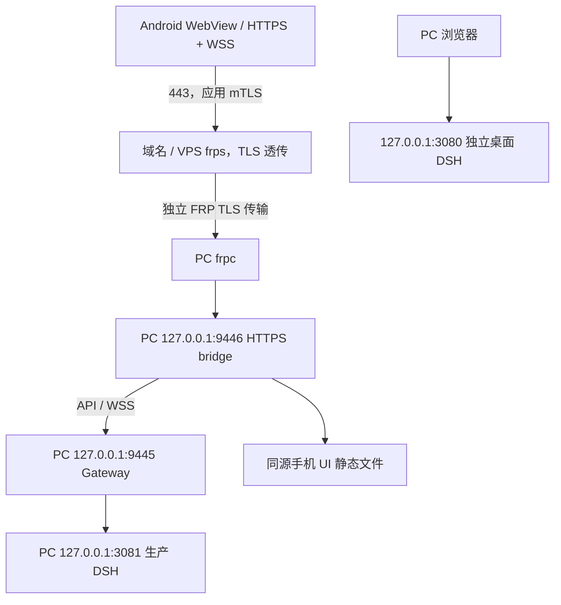

# DSH-Remote · Harness Remote

**通过 Android 手机与电脑上的 DeepSeek Harness（DSH）交互，让 PC 执行 Agent 工作，并把会话与回复实时返回手机。**

本项目包含 Android WebView APK 源码、移动聊天 UI、PC Gateway、生产进程管理器、Windows 配置向导和 HTTPS/WSS relay 配置模板。它是 [DeepSeek Harness](https://github.com/deepseek-ai/deepseek-harness) 的独立配套项目，不是 DeepSeek 官方手机应用。

> 当前阶段：可开发、可自行部署的源码快照。Windows 电脑与 Android 手机为主要适配目标；通用手机配对尚未完成。生产入口在代码中仍固定为 `relay.drm-jd.com:443`，因此克隆仓库并安装 APK **不等于**获得可直接使用的公共服务。自己的域名需要同步调整并重新构建客户端及服务端策略。不要连接作者的域名当作开放服务。

## 功能

- 在手机端新建、继续和切换 DSH 会话，收发指令和流式回复；PC 的实际工作权限由 DSH 运行账号、Agent 预设和工作区决定。
- 会话标题同步、重命名、工作区分组；分组别名与归档操作不直接删除 PC 文件夹。
- 模型、Agent 预设、推理强度设置同步到受支持的 DSH 实例。
- Markdown、代码块、LaTeX 渲染，复制/分支入口以及用量、耗时和完成时间展示；统计是否可用取决于上游事件数据。
- 主题调整与持久化、连接状态和断线恢复。
- Android KeyChain 用户选证书；只保存 alias 引用，不内嵌应用身份私钥。
- Phone Access Token 鉴权、短时 WebSocket ticket、Gateway 持久化和进程监督。
- Windows 图形化配置向导、桌面一键启动和环境诊断。

## 项目结构

```text
android/app/src/       Android Activity、图标、manifest 与网络安全策略
src/remote/           DSH Adapter、Gateway、认证、持久化、进程管理
src/remote/ui/        手机聊天页面、主题、Markdown/LaTeX 与第三方资源
scripts/             安装/启动/诊断、APK 与 UI 构建、历史开发工具
config/r9/           relay / FRP 配置模板，不含实际密钥
tests/               已有 Node 与 Android 静态/合同测试
design/              设计源文件与设计生成片段
docs/                电脑安装指南、架构与历史阶段说明
DSH-Remote.*         根目录兼容启动入口
```

`docs/` 中 R1–R9 的阶段材料保留历史设计背景，可能描述旧状态或本机路径。安装以本 README 和 [电脑端向导指南](docs/HARNESS-PC-SETUP.md) 为准。`scripts/` 中的证书签发、DNS、VPS 和历史探针工具不是首次安装入口，不应批量执行。

## 环境要求

| 部件 | 当前要求 |
| --- | --- |
| PC | Windows，Windows PowerShell 5.1+ |
| Node.js | 24+，含 npm/npx |
| DSH | 当前 Adapter/启动器基线为 `@deepseek-ai/dsh@0.1.5-rc.2`；需有效模型账号/配置 |
| 手机 | Android 8.0 / API 26+，可用的 Android System WebView |
| APK 构建 | Android SDK platform 34、build-tools 34.0.0、JDK 与 adb |
| 外网部署 | 自己的域名、可达的 relay/VPS、FRP 0.71.0 配置基线、独立应用与 FRP PKI |

SDK、JDK、Node、DSH 和 FRP 不随仓库分发。该仓库没有完整 Gradle Wrapper/Gradle app 构建配置；当前 APK 使用现有 Node 脚本直接调用 Android SDK 工具构建。

## 1. 安装 PC 组件

在 PowerShell 中：

```powershell
git clone https://github.com/JD14121/DSH-Remote.git
Set-Location DSH-Remote
npm ci
.\scripts\Harness-Remote-Setup.cmd
```

在向导中：

1. 选择**本次克隆的项目目录**和**默认工作区**。
2. 指定 DSH 数据目录、日志目录。若已有 DSH 历史，核对其真实数据目录；更换目录不会自动迁移历史。
3. 保持默认端口，或选择互不冲突的端口。
4. 首次先不勾选 relay，只完成电脑端配置。已经部署独立 relay/证书时，才导入对应的 bridge JSON、FRPC TOML 和 FRPC 可执行文件。
5. 点击「检查配置」，处理错误，再点击「保存并创建快捷方式」。缺少项目依赖也可在向导中安装。
6. 双击桌面 **Harness Remote** 启动。保存配置本身不会启动或重启服务。

统一配置默认为 `%LOCALAPPDATA%\HarnessRemote\pc-config.json`，只包含路径和选项。新安装默认开启合规门，不要使用旧部署的例外选项绕过错误。明确指定配置不存在时会报错，不会静默使用别人的路径。

常用命令：

```powershell
# 只诊断，不启动
.\scripts\harness-start.ps1 -DiagnoseOnly -NoPause
# 启动并复用健康的已运行进程
.\scripts\harness-start.ps1 -NoPause
# 状态 / 停止 / 重启
.\scripts\dsh-status.ps1 -Json
.\scripts\dsh-stop.ps1
.\scripts\dsh-restart.ps1
# 将生产 DSH 的浏览器登录交接给本机浏览器
.\scripts\dsh-browser-login.ps1
```

所有管理脚本支持 `-ConfigPath '配置文件绝对路径'`。Node 启动器支持环境变量 `HARNESS_REMOTE_CONFIG`。生产冷启动可能等待 npx 下载/缓存解析，默认预算为 180 秒。

## 2. 构建并安装 Android APK

当前构建工具面向 Windows：

```powershell
$env:ANDROID_HOME = 'C:\Android\Sdk'   # 替换为你的 SDK 路径
$env:JAVA_HOME = 'C:\Java\jdk'         # 替换为你的 JDK 路径

# localhost USB 开发版本
node scripts/r8g2-build-apk.mjs --variant development
adb install -r android/out/dsh-remote-debug.apk

# HTTPS relay 版本（仅部署完成后使用）
node scripts/r8g2-build-apk.mjs --variant relay
adb install -r android/out/dsh-remote-relay.apk
```

构建脚本自动生成**本地调试签名** `android/debug.keystore`。此文件已被 Git 忽略，不应上传；调试签名不是生产发布签名。两个构建变体可并存。设备上的旧 APK 若使用不同签名，不能直接覆盖；卸载会清除应用数据，应先自行备份。

### USB 本地开发

开发版本保持 `http://localhost:8099/`，通过 adb reverse 访问电脑的回环 UI：

```powershell
# 另开一个终端保持该服务运行，PC Gateway 应已就绪
node scripts/r8b-ui-server.mjs --port 8099
adb reverse tcp:8099 tcp:8099
```

随后打开开发 APK。默认是实际连接模式；带显式 `#fixture=...` 的页面属于合成 UI 测试，不代表已连接 DSH。此开发代理固定使用 Gateway 9445，因此 USB 开发时保留默认 Gateway 端口。

### Phone Access Token

Phone Access Token 是**本机 Gateway 的手机访问凭据**，不是 DigitalOcean、DNS 服务或 DeepSeek 的 API Key。Gateway 准备/启动后的受保护凭据应由操作者在本机查看，再输入手机 Authentication 页面：

```powershell
.\scripts\phone-token-show.ps1
```

此命令会显示敏感内容，请只在自己的终端执行，不要截图或提交到 GitHub。Token 可在手机端选择保存；它不能代替 HTTPS 客户端证书。需要轮换时使用 `scripts/phone-token-rotate.ps1` 并重新登录手机。

## 3. 外网网络拓扑与配置注意事项



| 默认端口 | 作用 | 暴露范围 |
| --- | --- | --- |
| 3080 | 原桌面 DSH | PC 回环，启动器保留已有进程 |
| 3081 | Gateway 管理的生产 DSH | PC 回环 |
| 9445 | Gateway API 与 WSS 上游 | PC 回环 |
| 9446 | 应用 HTTPS/mTLS 终止与同源 UI | PC 回环，由 frpc 转发 |
| 8099 | USB 开发 UI/代理 | PC 回环，仅开发 |
| 443 | 公共 relay 的 HTTPS 流量 | VPS 公网 |

部署顺序：

1. 准备自己的域名、DNS 与 VPS。公网只开放设计所需的 HTTPS、FRP 控制和受限管理端口；不要把 PC 的 3080/3081/9445 直接映射到公网。
2. 用 `config/r9/frps.production.toml`、`frpc.production.toml` 和 admission policy 作为模板，替换占位地址、证书/Token 文件引用。保持 HTTPS 单代理、固定回环目标和独立 FRP 身份；不得使用配置中示意的 D 盘路径当成真实材料。
3. 为应用 HTTPS 准备正确 SAN 的服务器证书；为手机单独签发应用客户端身份，并在 bridge 中配置 Android 应用 CA 和已登记的身份指纹。**FRP 传输 PKI 与 Android 应用 PKI 是不同信任域，不能混用。** CA 签名私钥需离线托管、备份和轮换，不上 GitHub、不装入 APK。
4. 运行 `node scripts/r9-relay-04-build-ui.mjs` 生成同源 UI 与完整性 manifest。输出默认在 `artifacts/r9-relay-04/`，须使用未存在的新输出目录；可设置 `R9_RELAY_04_UI_OUT`。部署生成的 `ui/` 和 `ui-manifest.json`，填写 `config/r9/bridge.r9-04.production.example.json` 的绝对路径、CA、身份指纹和 Origin。
5. 将你自己的运行配置存放在仓库外，再在安装向导中导入。启用 relay 时当前 bridge/Gateway 链路仍固定为 9446/9445。
6. 手机通过 Android 系统导入自己签发的客户端身份，在 KeyChain 选择界面明确授权 alias，然后输入 Phone Access Token。
7. 先验证 TLS、身份登记、Gateway READY，再验证新会话、历史上下文、发消息与 WSS 回复。PC Agent 操作应先用非破坏性指令验收。

**自定义生产域名目前需要开发改动。** 至少同时审查 `MainActivity.java` 中的生产 URL 与证书 host/port 白名单、Android 构建变体、network security config、Gateway Origin allowlist、bridge SNI/Origin、FRP customDomains、配置诊断及相关测试。只改 DNS 或 URL 会引发证书/SNI/Origin 拒绝；不要通过跳过 TLS 校验或扩张通配白名单解决。

服务器证书必须按正常 Android/WebView 规则验证。没有 `onReceivedSslError(...).proceed()` 旁路，不使用宽松 TrustManager、主机名验证绕过或为 relay 添加用户 CA 信任补丁。

### 常见故障

| 现象 | 优先检查 |
| --- | --- |
| `ERR_SSL_UNRECOGNIZED_NAME_ALERT` | 域名、SNI、bridge 主机名、FRP HTTPS 路由是否一致 |
| 页面无法打开/黑屏 | 9446 进程、FRPC 连接、UI manifest 与实际静态文件、WebView 版本 |
| Authentication 失败 | 使用的是 Phone Token 而非云 API Key；证书已登记，alias 可取到私钥/链 |
| `DSH_UNAVAILABLE` | `dsh-status.ps1 -Json`、生产 supervisor 日志、3081 的 DSH 登录/模型配置 |
| 无历史会话 | 数据目录、目标 DSH 实例、工作区、归档过滤；不要清空原数据目录 |
| 断网/重连 | WSS 与 Origin、VPS/FRP 网络、PC 睡眠、Gateway READY |

PC 必须保持开机和联网。关闭省电休眠、服务自启动和持续监控需由部署者按自己的环境配置；本项目目前提供一键启动，不承诺生产级无人值守 SLA。

## 开发与贡献

```powershell
npm ci
# 已有完整默认套件；部分历史测试/探针具有 Windows 或本机环境要求
npm test
# 配置与生命周期的定向回归
node --test tests/remote/harness-pc-config.test.mjs tests/remote/r7-production-config.test.mjs tests/remote/r7c-lifecycle-closure.test.mjs tests/remote/r7d-production-port.test.mjs
```

这次开源整理未对新用户环境宣称全套测试或生产部署已通过。提交 Issue 时注明 Windows/Android/WebView/DSH 版本、请求 ID 和脱敏日志；禁止上传密钥、Token、Cookie 或聊天隐私。参见 [SECURITY.md](SECURITY.md) 与 [第三方许可](THIRD_PARTY_NOTICES.md)。

后续重点：通用服务地址与安全配对、独立签名发布、可回滚升级、启动互斥与持续诊断、多设备与多版本兼容。

## 许可证

项目原创代码采用 [MIT](LICENSE)，Copyright © 2026 JD14121。第三方资源保留原许可证；名称与图标不代表官方背书，MIT 不授予商标权。
