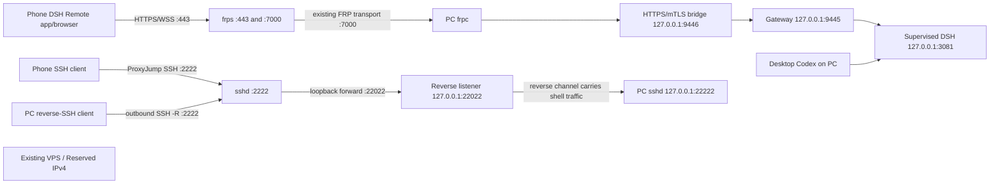

# R9 transport ADR v4 — SSH management path alongside the mobile relay

**Status: PROPOSED — redesign authorized; deployment and firewall mutation are not authorized by this ADR.**

Date: 2026-09-30. This proposal supersedes the v3 NO-SSH decision for design purposes. It preserves the deployed R9 mobile HTTPS path and adds a separately authenticated SSH path for shell access to the PC. It does not convert SSH into the DSH chat protocol.

## 1. Decision

Add an isolated reverse-SSH management path through the existing VPS, using a new public TCP port `2222`. Keep public TCP `22` closed. The PC initiates the reverse connection, so no home-router port-forward or Internet-facing Windows SSH listener is needed. The VPS carries the SSH stream only; it does not terminate or inspect DSH Remote HTTPS traffic.

The Android DSH Remote client continues to use the existing HTTPS/mTLS application route on TCP `443`. The FRP control/transport route remains on TCP `7000`, restricted to the measured PC egress `/32`. Existing Gateway and DSH ports remain loopback-only and unmapped by FRP or SSH.

SSH clients must be an Android SSH client (for phone administration) and OpenSSH/Codex remote tooling (if Codex itself runs on a different machine). The native ChatGPT mobile app does not originate SSH connections. The phone's DSH Remote chat UI remains the HTTPS client.

## 2. Proposed topology

The SSH line is two independent public-key-authenticated hops:

1. The PC maintains `ssh -N -R 127.0.0.1:22022:127.0.0.1:22222` to the VPS on TCP `2222`.
2. The phone connects through the VPS with `ProxyJump` to the VPS loopback listener `127.0.0.1:22022`, reaching the PC's loopback-only `sshd` on `127.0.0.1:22222`.

The reverse listener must stay bound to VPS loopback (`GatewayPorts no`); it must never become a second public listener. The PC uses two separately constrained listeners: TCP `22` on the assigned Tailscale address to retain that private path, and `127.0.0.1:22222` for the public reverse tunnel. TCP `22` must not bind to Ethernet/LAN/Wi-Fi or a wildcard address.

## 3. Port and firewall plan

| Endpoint | Proposed reachability | Change |
|---|---|---|
| VPS anchor `10.15.0.5:443/TCP` | Public IPv4, existing relay | Preserve exactly |
| VPS anchor `10.15.0.5:7000/TCP` | PC egress `/32` only, existing FRP | Preserve exact source restriction; remeasure egress before any firewall edit |
| VPS anchor `10.15.0.5:2222/TCP` | New SSH jump endpoint | Add one DigitalOcean Cloud Firewall inbound rule, IPv4 only; source is the phone's stable public egress `/32` if one exists, otherwise `0.0.0.0/0` is required for mobile-network roaming |
| VPS TCP `22`, `80`, IPv6 | Closed / absent | Keep closed; do not add DNS AAAA or wildcard listeners |
| VPS loopback `127.0.0.1:22022` | PC reverse SSH endpoint | New, loopback only; no Cloud Firewall rule |
| PC Tailscale address `T:22` | Existing private SSH path | Preserve and bind only to the assigned Tailscale address; no router/NAT/public firewall rule |
| PC `127.0.0.1:22222` | PC OpenSSH target for reverse tunnel | New, loopback only; no router/NAT/public Windows Firewall rule |
| PC `127.0.0.1:9446` | Existing HTTPS/mTLS bridge | Preserve |
| PC `127.0.0.1:9445`, `:3080`, `:3081` | Existing Gateway/operator/supervised DSH | Preserve; never expose through SSH forwarding or FRP |
| VPS `127.0.0.1:19100` | Existing admission plugin | Preserve loopback-only |

The current repository runbook records `443` open to IPv4 and `7000` restricted to `223.17.90.121/32`; it also says the formal Gate 11 firewall acceptance rerun was pending. This is recorded evidence, not a claim about the live firewall today. Before adding `2222`, capture the current attached Cloud Firewall through the existing read-only Gate 11 path. Do not replace the firewall or edit the existing `443`/`7000` rules.

The VPS host was recorded with UFW inactive/default-ACCEPT in the runtime design evidence. Do not enable UFW as part of this additive change: that could interrupt the accepted `443` and `7000` paths. The Cloud Firewall remains the perimeter control for `2222`; the SSH service binds only to the approved anchor address. A later defense-in-depth host-firewall plan must explicitly preserve and verify every current service before activation.

The Windows OpenSSH installer can create an inbound allow rule for TCP `22`. Current PC inspection found the `OpenSSH-Server-In-TCP` rule enabled for the Private profile, with `LocalAddress=Any`, `RemoteAddress=Any`, and `InterfaceAlias=Any`; Ethernet is Public and Tailscale is Private. The operator wants the Tailscale path retained, but confirms Tailscale SSH has never connected successfully; treat it as a desired private path to validate, not a working service. Tailscale is Running/Automatic at IPv4 `100.85.25.125`. `sshd` is stopped/manual and no listener was observed on `22`, `2222`, or `22222`. Windows OpenSSH Server is version `9.5.6.2` (`OpenSSH_9.5p2 for Windows`). `%ProgramData%\ssh` had no files; its ACL was narrowed to SYSTEM and Administrators, and the operator generated an Ed25519 host key with fingerprint `SHA256:zJWiyS5X5zu1p0MjSmi0B+PPuKsiiWyinlioUb9mPUc`. The config is still absent. Before starting sshd, stage a config that binds TCP `22` only to `100.85.25.125` and the reverse-tunnel target only to `127.0.0.1:22222`. Restrict the existing TCP/22 firewall rule to the Tailscale interface/address rather than disabling it or leaving its `Any` scope. `sshd -t` and `sshd -T` exited 1 before host-key generation because the config was absent. Do not start the service to auto-generate defaults; syntax-check the reviewed dual-listener config before starting the service.

## 4. SSH identity and account boundaries

Use separate keys and accounts for each role; do not reuse FRP PKI, Android client certificates, Phone Access Token, Gateway bearer, or a Codex/DSH credential.

| Identity | Location/use | Restriction |
|---|---|---|
| VPS SSH host key | VPS; pinned on phone and PC | Verify out-of-band through DigitalOcean Recovery Console before first use |
| PC SSH host key | PC; pinned on clients | Verify fingerprint locally before first remote connection |
| `dsh-reverse` client key | PC reverse-tunnel service | VPS account has no shell/PTY/sudo; remote forwarding only; `PermitListen 127.0.0.1:22022`; one fixed key |
| `dsh-phone-hop` key | Phone SSH client | VPS account has no shell/PTY/sudo; local forwarding only; `PermitOpen 127.0.0.1:22022` |
| PC login key | Phone (and a separate Codex client key only if needed) | Current account `jd14121\13006` is in Administrators; restrict logins to this identity, use `administrators_authorized_keys` with SYSTEM/Administrators-only ACL, and treat every authorized key as an admin-shell credential |

Require public-key authentication only for these accounts, disable password login on the new public jump endpoint, disable agent/X11 forwarding and TTY for the two VPS forwarding-only users, cap authentication attempts, log bounded auth events, and keep host-key checking strict. Apply `AllowTcpForwarding` directionally (`remote` for the PC tunnel account, `local` for the phone hop account), `PermitListen`, `PermitOpen`, and `GatewayPorts no`. Validate the installed OpenSSH version supports each selected directive before rollout.

Windows OpenSSH uses `%ProgramData%\ssh\sshd_config`; changes require a service restart. The selected current account is an administrator, so configure `Match Group administrators` to use `%ProgramData%\ssh\administrators_authorized_keys`, protect that file so only SYSTEM and Administrators can read it, and restrict `AllowUsers` to `jd14121\13006`. This grants an administrator shell to each authorized key; use separate phone/Codex client keys and remove a device's key immediately if it is lost. A dedicated non-administrator account remains a later least-privilege option if the operator changes this account choice. Do not enable the default broad inbound firewall rule merely to make loopback forwarding work.

## 5. Deployment gates and operator actions

This ADR does not execute these steps. The order below keeps the existing HTTPS path available if SSH setup fails.

1. **Read-only baseline:** from DigitalOcean's provider Recovery Console and read-only firewall audit, record the attached firewall, current listeners, SSH packages/config, anchor binding, and current Reserved-IP route. On Windows, use elevated PowerShell to check OpenSSH capability, service, listeners, firewall rules, `C:\ProgramData\ssh` contents/ACLs, host-key files, and `sshd.exe` version. Do not start services or alter rules.
2. **Offline design review:** approve dedicated account names, client public-key custody, host-key fingerprint verification, phone SSH client, Windows account, and recovery plan. Generate private keys only on their eventual clients; transfer only public keys.
3. **PC local rehearsal:** create and syntax-check the reviewed Windows OpenSSH config before starting the service; do not let first service start generate the default config. Bind TCP `22` only to the actual Tailscale address and `22222` only to `127.0.0.1`; use key-only auth and a dedicated non-admin account. Restrict `OpenSSH-Server-In-TCP` to Tailscale rather than disabling it or leaving it broad. Verify Tailscale SSH and loopback SSH independently before creating an outbound tunnel.
4. **VPS local staging:** use Recovery Console (kept as break-glass management) to stage sshd on `10.15.0.5:2222`, forwarding-only accounts and restrictions. Keep Cloud Firewall TCP `2222` closed during this stage. Verify the existing frps listeners on `10.15.0.5:443` and `:7000` remain intact.
5. **Additive firewall gate:** after stage 4 passes, add only TCP `2222` to the already-attached Cloud Firewall. Prefer the phone's stable IPv4 `/32`; if it roams across carrier/Wi-Fi egress addresses, the realistic source is `0.0.0.0/0`, which makes the SSH endpoint publicly reachable and raises the importance of key-only accounts/rate controls. Keep `22`, `80`, IPv6, and all app/Gateway/DSH ports closed.
6. **Reverse tunnel and phone acceptance:** start the PC reverse tunnel as a separately owned Scheduled Task/service with bounded reconnect, `ExitOnForwardFailure`, keepalives, and least-privilege access to its private key. Confirm phone SSH can reach the PC shell through `ProxyJump`; confirm failed/wrong keys are rejected. In parallel, confirm the existing DSH Remote HTTPS/WSS flow still uses `443`/`7000` and the exact same sessions.
7. **Codex access (optional):** if Codex already runs on this PC, continue using the local project and DSH bridge. If Codex runs elsewhere, add a separate client key and explicit least-privilege account; do not share the phone key.

## 6. Acceptance and rollback

Before accepting the new rule, update the R9 exposure audit to expect TCP `2222` on the Reserved-IP path while continuing to require TCP `22` closed, TCP `7000` restricted to the PC `/32`, and no public `9445`, `9446`, `3080`, `3081`, or `19100`. Probe both the Reserved IP and the Droplet's direct public IPv4: `2222` should work only through the approved Reserved-IP/anchor path; it must not bypass through the Droplet address. Repeat the existing HTTPS/mTLS positive and negative checks; don't treat an SSH login as proof of application health.

Rollback is additive and independent: stop the PC reverse-tunnel task, remove only the new Cloud Firewall `2222` allow rule, then stop/disable only the dedicated VPS `sshd` configuration/account and PC `sshd` service. Leave `443`, `7000`, DNS, bridge, Gateway, DSH and Android enrollment untouched. Do not use DNS deletion as SSH revocation. If a key is lost, remove its one account/key immediately and terminate its active SSH sessions; rotate only that SSH role's key.

## 7. Open risks and decision points

- If the phone has no stable public IPv4, TCP `2222` must be source-open on IPv4; non-standard port selection is separation, not meaningful protection against scanning.
- Reverse SSH adds a publicly reachable OpenSSH daemon and an always-on PC outbound tunnel. It expands the attack surface even though the DSH application ports remain private.
- Codex is not made a phone SSH client, and SSH does not make ChatGPT itself connect to DSH. Phone chat remains on the existing DSH Remote HTTPS application.
- The PC's OpenSSH installation state, the live VPS sshd state, and the live Cloud Firewall must be rechecked at the next gate; this ADR deliberately relies only on recorded reports and current read-only PC checks.
- Do not claim same-session equivalence until DSH Remote and desktop Codex are verified against the same supervised DSH instance. SSH transport alone cannot establish that application-level fact.

**Current result: design/evaluation complete. No service, configuration, or firewall was changed. Awaiting approval to begin Gate 1 read-only baseline and then the staged setup.**

## References

- [R9 v3 transport ADR (superseded for the NO-SSH decision)](R9-TRANSPORT-ADR-v3.md)
- [R9-RELAY-03B live runbook](../../deliverables/R9-RELAY-03B/R9-RELAY-03B-LIVE-RUNBOOK.md)
- [Microsoft: OpenSSH Server for Windows configuration](https://learn.microsoft.com/en-us/windows-server/administration/openssh/openssh-server-configuration)
- [Microsoft: OpenSSH Server first-use setup](https://learn.microsoft.com/en-us/windows-server/administration/openssh/openssh_install_firstuse)
- [OpenBSD: sshd_config forwarding controls](https://man.openbsd.org/sshd_config)
